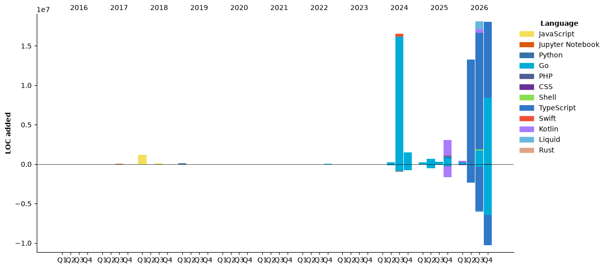

### Hi there 👋
 I'm Ed. I'm a backend software engineer and founder with a passion for Blockchain, AI, Open Source, Diversity & Inclusion.

<br />

<h2>GitHub Stats</h2>
<p>
  
  <br />
  
</p>

<!--START_SECTION:waka-->


**I'm an Early 🐤** 

```text
🌞 Morning                41325 commits       ██████░░░░░░░░░░░░░░░░░░░   24.65 % 
🌆 Daytime                87655 commits       █████████████░░░░░░░░░░░░   52.28 % 
🌃 Evening                36572 commits       █████░░░░░░░░░░░░░░░░░░░░   21.81 % 
🌙 Night                  2117 commits        ░░░░░░░░░░░░░░░░░░░░░░░░░   01.26 % 
```


📊 **This Week I Spent My Time On** 

```text
🕑︎ Time Zone: Europe/London

💬 Programming Languages: 
Markdown                 9 hrs 40 mins       █████████░░░░░░░░░░░░░░░░   35.44 % 
Other                    8 hrs 41 mins       ████████░░░░░░░░░░░░░░░░░   31.80 % 
TypeScript               3 hrs 59 mins       ████░░░░░░░░░░░░░░░░░░░░░   14.61 % 
Go                       2 hrs 16 mins       ██░░░░░░░░░░░░░░░░░░░░░░░   08.31 % 
Bash                     1 hr 26 mins        █░░░░░░░░░░░░░░░░░░░░░░░░   05.26 % 

🔥 Editors: 
Claude Code              26 hrs 13 mins      ████████████████████████░   96.01 % 
VS Code                  45 mins             █░░░░░░░░░░░░░░░░░░░░░░░░   02.80 % 
Codex Vscode             19 mins             ░░░░░░░░░░░░░░░░░░░░░░░░░   01.17 % 
Codex CLI                0 secs              ░░░░░░░░░░░░░░░░░░░░░░░░░   00.02 % 
```

🤖 **AI Coding This Week** 

```text
⏱ AI Coding Time: 27 hrs 13 mins (99.67%)

✍️ 18,473 lines written by AI, 11 lines written by hand (99.94% AI-written)

🔤 35,178,060 Input Tokens, 4,912,913 Output Tokens

💵 $824.96 Estimated AI Cost This Week

🧠 218 AI Sessions, 606 AI Prompts

Opus                     16,554 lines        ███████████████████░░░░░░   77.31 % 
Fable                    2,416 lines         ███░░░░░░░░░░░░░░░░░░░░░░   11.28 % 
Sonnet                   2,392 lines         ███░░░░░░░░░░░░░░░░░░░░░░   11.17 % 
GPT                      51 lines            ░░░░░░░░░░░░░░░░░░░░░░░░░   00.24 % 
Codex-Cli                0 lines             ░░░░░░░░░░░░░░░░░░░░░░░░░   00.00 % 

🔎 AI Coding Insights:
🤖 AI-Driven — 99.94% of written lines came from AI
📚 Verbose Prompter — average 2,443 characters per prompt
🔁 Iterative Prompter — average 3 prompts per session
🚀 High AI Trust — 0.06% of changed lines were hand-edited
```

**Timeline**




 Last Updated on 04/11/2026 05:58:56 UTC
<!--END_SECTION:waka-->


<p>
<a href="https://stackoverflow.com/users/1014632/ech" target="_blank"></a> 
<a href="https://x.com/e_harrod" target="_blank"></a> 
<a href="https://www.linkedin.com/in/ed-harrod" target="_blank"></a>
